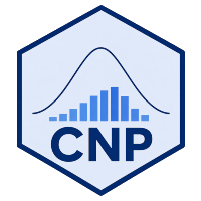

## Improving Equivalent Scores

::: {.grid}

::: {.g-col-12 .g-col-md-2}

:::

::: {.g-col-12 .g-col-md-10}
Code and materials of the method described in *Improving Equivalent Scores for
Clinical Neuropsychology: A new method for regression model selection* (Arcara,
2024), for building regression-based normative data.

- [Reg-Method-Norm-Data-Sim](https://github.com/giorgioarcara/Reg-Method-Norm-Data-Sim) — the simulations of the article.
- [Reg-Method-Norm-Data-CodeApp](https://github.com/giorgioarcara/Reg-Method-Norm-Data-CodeApp) — the code of the online app and the tutorials to apply the method.
- [Reg-Method-App](https://giorgioarcara.shinyapps.io/Reg-Method-App/) — the online app.

:::

:::

## cnp

::: {.grid}

::: {.g-col-12 .g-col-md-2}

:::

::: {.g-col-12 .g-col-md-10}
[cnp](https://github.com/giorgioarcara/cnp) (Clinical Neuropsychology
Psychometrics) is an R package providing psychometric methods for normative data
in clinical neuropsychology. It currently focuses on utility functions to build
regression-based norms and to test new normative methods: regression-based
adjustment of raw scores for age, education and sex, Equivalent Scores
classification, and simulation of normative data with a known ground-truth model.
The package is not yet on CRAN and is installed from GitHub.

_Development stage:_ work in progress

:::

:::

## Code collections

::: {.grid}

::: {.g-col-12 .g-col-md-2}

:::

::: {.g-col-12 .g-col-md-10}
Collections of code snippets developed over the years, kept public so that they
can be reused:

- [R-code-Misc](https://github.com/giorgioarcara/R-code-Misc) — miscellaneous R code.
- [Matlab-code-Misc](https://github.com/giorgioarcara/Matlab-code-Misc) — the Matlab functions.
- [Other-code-misc](https://github.com/giorgioarcara/Other-code-misc) — snippets in several other languages.

:::

:::


