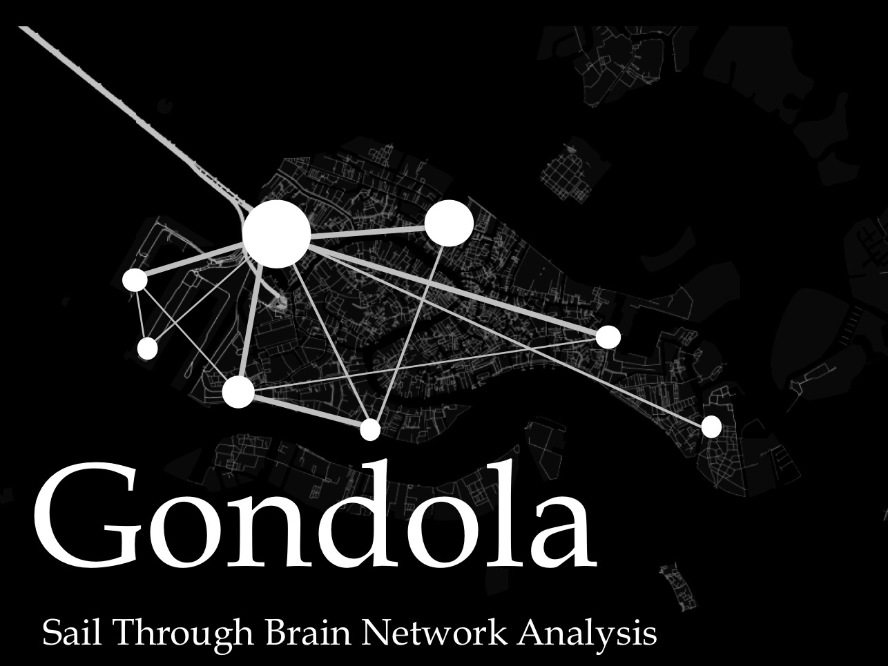

## Herbert

::: {.grid}

::: {.g-col-12 .g-col-md-2}

:::

::: {.g-col-12 .g-col-md-10}
**Maintainer(s)** [Alessandro Tonin](https://github.com/Lychfindel), &nbsp; [Ettore Napoli](https://github.com/anemos96)

[Herbert](https://github.com/SanCamilloIRCCS-OndaLab/Herbert) (an EEG
Reproducible Brain Exploration Research Toolbox) is an open-source toolbox for
building modular pipelines for connectivity and network analysis of resting-state
M/EEG data. Its design encourages multiverse pipelines, where each branch
explores the effect of a different parameter or algorithm within the same
pipeline. The full documentation is available on the
[Herbert website](https://sancamilloirccs-ondalab.github.io/Herbert/).

_Development stage:_ under development

:::

:::

## Gondola

::: {.grid}

::: {.g-col-12 .g-col-md-2}

:::

::: {.g-col-12 .g-col-md-10}
**Maintainer(s)** [Alessandro Tonin](https://github.com/Lychfindel), &nbsp; [Ettore Napoli](https://github.com/anemos96)

[Gondola](https://github.com/giorgioarcara/Gondola) is a Matlab Toolbox to facilitate brain network analysis.

_Development stage:_ final stages

:::

:::

## EEG-NPSY tutorial

::: {.grid}

::: {.g-col-12 .g-col-md-2}

:::

::: {.g-col-12 .g-col-md-10}
The [EEG-NPSY tutorial](https://sancamilloirccs-ondalab.github.io/tutorial_EEG-NPSY/)
is a tutorial for EEG data analysis developed by the ONDA Lab, with the same
analyses provided in **Python**, **R** and **Matlab**. The code is on
[GitHub](https://github.com/SanCamilloIRCCS-OndaLab/tutorial_EEG-NPSY).

:::

:::


