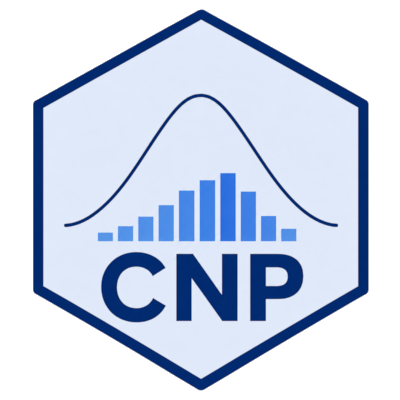

## San Camillo Apps

::: {.grid}

::: {.g-col-12 .g-col-md-2}

:::

::: {.g-col-12 .g-col-md-10}
[San Camillo Apps](https://app.hsancamillo.it/) is the collection of interactive
web applications of IRCCS San Camillo. The
[Clinical Support](https://app.hsancamillo.it/#apps-clinical) section gathers the
apps meant to be used in clinical practice, such as the normative data calculator
for the MoCA.

_Please note:_ the collection **is currently being restructured**, so the set of
available apps and their links may change in the coming months.

:::

:::

## GEMS, Tele-GEMS and Auto-GEMS

::: {.grid}

::: {.g-col-12 .g-col-md-2}

:::

::: {.g-col-12 .g-col-md-10}
**GEMS**, **Tele-GEMS** and **Auto-GEMS** are open-access cognitive screening
tests: the original in-person version, a version for remote administration, and
a self-administered version.

A [provisional website](https://giorgioarcara.github.io/gems-tests/) collects the
three tests, their materials in the available languages, and the online
calculators ([GEMS](https://giorgioarcara.shinyapps.io/GEMS_app/),
[Tele-GEMS](https://sonia-montemurro.shinyapps.io/Tele-GEMS_Shiny/)). The
original OSF projects remain available:
[GEMS](https://osf.io/4t5a8/), [Tele-GEMS](https://osf.io/t3bma/),
[Auto-GEMS](https://osf.io/fq8g7/).

_Please note:_ these tests are **collaborative projects** involving several
groups and researchers beyond the ONDA Lab, and the website above is a temporary
page.

:::

:::

## cnp

::: {.grid}

::: {.g-col-12 .g-col-md-2}

:::

::: {.g-col-12 .g-col-md-10}
[cnp](https://github.com/giorgioarcara/cnp) is an R package for test development
and norming in clinical neuropsychology, useful when building the normative data
of a new test. See [Analysis methods](analysis-methods.qmd) for details.

_Development stage:_ work in progress

:::

:::


